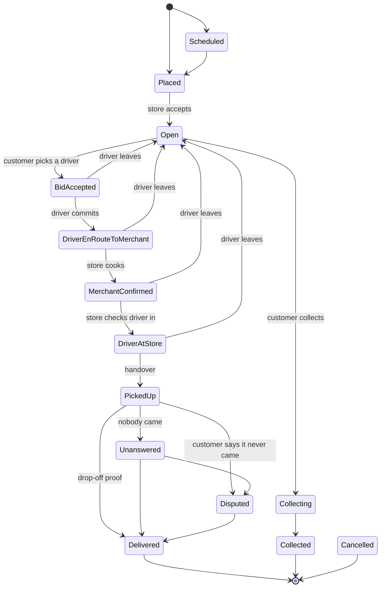

# Order states

Every order moves through one of two state machines: a **delivery** (store,
driver, customer) or a **pickup** (store and customer). This page is the
specification. The two tables below are rendered from the same function
validation calls (`DeliveryStatus::transition_requirement` and
`PickupStatus::transition_requirement` in `dispatch_types`), and a test
(`dispatch_types::lifecycle_tests`) fails if they differ, so the page can't
drift from the rules the network enforces.

Every peer checks every step: a step not in a table, or written by someone
the table doesn't name, is refused, however modified the writer's app is.

## Delivery

Not drawn: cancelling, which any state before the handover allows (see the
table), and moving to `Collecting` from any state between `Open` and
`MerchantConfirmed`.

<!-- delivery:begin -->
| From | To | Who may write it |
|---|---|---|
| Scheduled | Placed | customer |
| Scheduled | Cancelled | customer or store |
| Placed | Open | store |
| Placed | Cancelled | customer or store |
| Open | BidAccepted | customer |
| Open | Cancelled | customer or store |
| Open | Collecting | store |
| BidAccepted | Open | store or driver |
| BidAccepted | DriverEnRouteToMerchant | driver |
| BidAccepted | Cancelled | customer or store |
| BidAccepted | Collecting | store |
| DriverEnRouteToMerchant | Open | store or driver |
| DriverEnRouteToMerchant | MerchantConfirmed | store |
| DriverEnRouteToMerchant | Cancelled | customer or store |
| DriverEnRouteToMerchant | Collecting | store |
| MerchantConfirmed | Open | store or driver |
| MerchantConfirmed | DriverAtStore | store |
| MerchantConfirmed | Cancelled | customer or store |
| MerchantConfirmed | Collecting | store |
| DriverAtStore | Open | driver |
| DriverAtStore | PickedUp | store or driver |
| DriverAtStore | Cancelled | any of the three |
| PickedUp | Delivered | customer or driver |
| PickedUp | Disputed | customer |
| PickedUp | Unanswered | driver |
| Disputed | Delivered | customer or driver |
| Collecting | Cancelled | customer or store |
| Collecting | Collected | customer or store |
| Unanswered | Delivered | customer or driver |
| Unanswered | Disputed | customer |
<!-- delivery:end -->

## Pickup

<!-- pickup:begin -->
| From | To | Who may write it |
|---|---|---|
| Placed | MerchantConfirmed | store |
| Placed | Cancelled | customer or store |
| MerchantConfirmed | ReadyForPickup | store |
| MerchantConfirmed | Cancelled | customer or store |
| ReadyForPickup | PickedUp | customer |
| ReadyForPickup | Cancelled | customer or store |
| ReadyForPickup | Disputed | customer |
| Disputed | ReadyForPickup | store |
| Disputed | PickedUp | customer |
| Disputed | Cancelled | store |
<!-- pickup:end -->

## What else a step needs

Who may write a step is only the first check. Validation also checks each
step's fields and what it cites (`dispatch_integrity::delivery` and
`::pickup`). The ones money rests on:

| Step | Needs |
|---|---|
| Store accepts (`Placed` → `Open`, pickup `Placed` → `MerchantConfirmed`) | The store's hold on the customer's card for exactly what the order's terms say, priced from its current menu |
| Driver commits (`BidAccepted` → `DriverEnRouteToMerchant`) | Both of the driver's holds: their collateral on the store's account, and their pay on the store's card. Leaving the order releases both |
| Handover (`DriverAtStore` → `PickedUp`) | The store's record of handing the food over |
| Delivered | Proof it reached the customer: the driver scanned their code, the customer confirmed it themselves, or it was left at the door as they chose (`attestation_types::dropoff_proof`) |
| A store kept the driver waiting; an order lapsed on a silent store | A round of the network's time source (drand), verified in validation, never the writer's own clock |

Payments follow from these states and are settled by each payee's own
payment agent (`docs/DIRECT_PAYMENTS.md`). Disputes and the store's
decisions on them are in `docs/SECURITY.md`.

## When two parties act at once

An order's history can branch: two parties may each update the same
version, and Holochain can't say which came first. Its current version is
the tip of its longest branch, never the latest timestamp. No rule that
moves money depends on which branch wins: each one that could conflict
across branches is decided on a single author's own chain
(`dispatch_types::lineage`). A driver can't both leave an order and pick it
up, a store can't both move a driver on and check them in, and a customer
can't both cancel and claim the driver's pay back. Each such pair is tested by writing
the second step on the older version, past the app's own checks
(`tests/tryorama/src/conflicting-steps.test.ts` and `conflicting-releases`,
`handed-over`, `stale-cancel`, `deadline-proofs`, `store-silence`). Where both
steps are valid, the money is settled and checked: one driver released twice at
once pays for the food once, and a delivery completed twice at once pays each
party once and counts once on the driver's record.

## Properties the tests hold the tables to

- A finished order (`Delivered`, `Collected`, `Cancelled`; for pickup,
  `PickedUp`, `Cancelled`) never moves again, and no step leads back to the
  state it left.
- Every state is reachable, and from every state an order can finish.
- Once the food has left the store, the order is never simply cancelled,
  reopened or handed to a collector.
- `Delivered` comes only after the handover, and only from the customer or
  the driver holding their proof.
- Each party decides only what's theirs: the customer picks the driver
  (which reveals their address to them alone) and alone says an order never
  came; the store accepts, cooks, checks drivers in and hands over to a
  collecting customer; the driver alone commits or says nobody answered,
  and never calls an order off on their own before they're at the counter.
